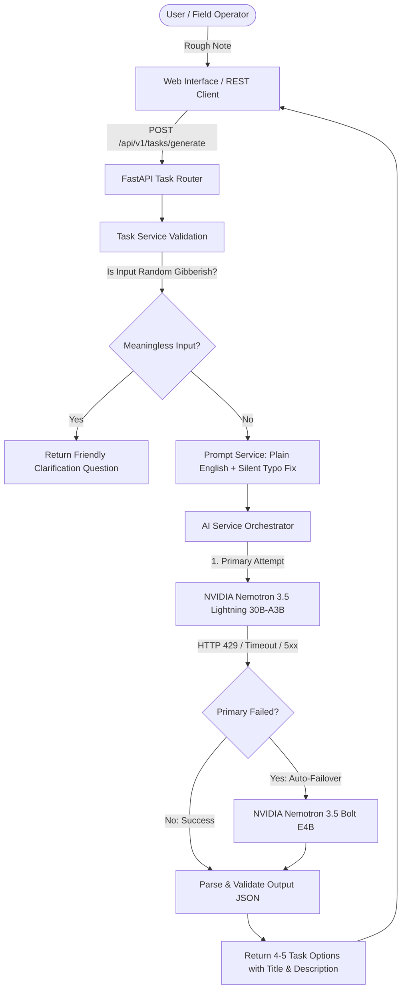

# AI VMS Task Generator

An intelligent, production-ready microservice built with **Python FastAPI** and **NVIDIA Nemotron** large language models. Designed for Video Management System (VMS) operations teams, it transforms rough, incomplete, grammatically flawed, or typo-ridden technician notes into professional task titles and meaningful issue descriptions.

[](https://www.python.org/)
[](https://fastapi.tiangolo.com/)
[](https://build.nvidia.com/)
[](https://build.nvidia.com/)
[]()

---

## 📌 Problem & Purpose

In 24/7 security control rooms and VMS field maintenance, operators and technicians frequently submit urgent issue reports using broken English, shorthand, or heavy typos:

> *"cam 3 scren blak aftr rebot on pakring lot vms servr fix urgnt"*

Logging such notes directly into ticketing systems (Jira, ServiceNow, Remedy) leads to miscommunication, delayed triage, and lost details.

**AI VMS Task Generator** bridges this gap:
1. **Understands Intent**: Extracts the core problem regardless of grammar, abbreviations, or spelling errors.
2. **Generates 4 to 5 Professional Variations**: Presents candidate options so operators can pick the phrasing that best fits their workflow.
3. **Structured & Plain Output**: Produces a clean **TASK TITLE / ISSUE** and a concise **DESCRIPTION** (2 to 3 clear sentences) written in plain everyday English.
4. **Zero Downtime with Dual AI Providers**: Automatically fails over to a secondary AI provider if the primary provider hits rate limits or experiences an outage.

---

## 🏗️ Architecture & Request Flow



---

## ✨ Key Features

- **Direct, Uncluttered Format**: Each option provides strictly:
  - **TASK TITLE / ISSUE**: Clear, one-sentence summary of the problem.
  - **DESCRIPTION**: 2 to 3 simple, easy-to-understand sentences explaining what happened and what needs to be checked.
- **Silent Auto-Correction**: Silently corrects technical abbreviations and typos without asking unnecessary follow-up questions.
- **Plain Everyday English**: Prompts enforce natural, accessible language free of robotic jargon (e.g., no confusing terms like *"ingress/egress"*, *"situational awareness"*, or *"operational oversight"*).
- **Multiple Options to Pick**: Generates 4 or 5 distinct variations so technicians or managers can select the best one or copy it with a single click.
- **Automatic Fallback Provider**: Includes built-in failover to **`nvidia/nemotron-3.5-bolt-e4b`** when the primary **`nvidia/nemotron-3.5-lightning-30b-a3b`** model hits rate limits (429), quota limits, connection timeouts, or service interruptions.
- **Smart Clarification Guard**: Clarification is strictly triggered only when the input is 100% meaningless (such as keyboard mash `"asdfghjkl"` or single-character repetitions).
- **Interactive Web UI**: Lightweight, self-contained single-page interface served directly at `http://localhost:8086/`.

---

## 📁 Project Structure

```text
ai-vms-generator/
├── api/
│   └── index.py                 # Vercel serverless entrypoint exposing FastAPI app
├── app/
│   ├── routes/
│   │   └── task_routes.py       # API endpoints (/tasks/generate, /health, /info)
│   ├── services/
│   │   ├── ai_service.py        # Dual-model AI client with auto-failover
│   │   ├── prompt_service.py    # System & user prompts enforcing plain language & JSON
│   │   └── task_service.py      # Business logic, validation, and JSON extraction
│   ├── static/
│   │   └── index.html           # Responsive Web UI (selection, copy, fallback badge)
│   ├── config.py                # Pydantic configuration & environment settings
│   └── main.py                  # FastAPI application factory, CORS, static mounting
├── tests/
│   └── test_task.py             # 28 unit and integration tests (pytest)
├── .env.example                 # Environment configuration template
├── .gitignore                   # Complete Git ignore rules (Python, venv, IDE, OS)
├── .vercelignore                # Vercel build ignore rules
├── requirements.txt             # Production and test dependencies
├── run.py                       # Local startup script loading host/port from .env
├── vercel.json                  # Vercel build and routing configuration
└── README.md                    # Project documentation
```

---

## ⚙️ Configuration Reference (`.env`)

Copy `.env.example` to `.env` and fill in your NVIDIA NIM credentials:

```bash
cp .env.example .env
```

| Variable | Type | Default | Description |
| :--- | :--- | :--- | :--- |
| `NVIDIA_API_KEY` | `string` | *(Required)* | API key for NVIDIA NIM API (`nvapi-...`). |
| `NVIDIA_BASE_URL` | `string` | `https://integrate.api.nvidia.com/v1` | Base URL for primary NVIDIA NIM endpoint. |
| `NVIDIA_MODEL` | `string` | `nvidia/nemotron-3.5-lightning-30b-a3b` | Primary AI model for task generation. |
| `FALLBACK_ENABLED` | `boolean`| `True` | Enables automatic failover to the secondary model. |
| `FALLBACK_API_KEY` | `string` | *(Optional)* | Dedicated fallback API key. Defaults to `NVIDIA_API_KEY` if omitted. |
| `FALLBACK_BASE_URL`| `string` | `https://integrate.api.nvidia.com/v1` | Base URL for secondary AI provider. |
| `FALLBACK_MODEL` | `string` | `nvidia/nemotron-3.5-bolt-e4b` | Secondary AI model used during outages or rate limits. |
| `TEMPERATURE` | `float` | `0.3` | Model temperature (lower values ensure consistency and adherence). |
| `MAX_TOKENS` | `integer`| `1800` | Maximum tokens per completion response. |
| `TIMEOUT_SECONDS` | `float` | `60.0` | Request timeout before triggering fallback. |
| `MAX_RETRIES` | `integer`| `2` | Number of internal retry attempts per model tier. |
| `APP_HOST` | `string` | `127.0.0.1` | Server bind host. |
| `APP_PORT` | `integer`| `8086` | Server bind port. |

---

## 🚀 Quick Start

### 1. Prerequisites
- **Python 3.10** or higher
- An active **NVIDIA NIM API Key** (obtainable from [build.nvidia.com](https://build.nvidia.com/))

### 2. Clone and Setup Environment

```bash
# Clone the repository
git clone https://github.com/your-org/ai-vms-generator.git
cd ai-vms-generator

# Create and activate virtual environment
python -m venv venv

# Windows:
venv\Scripts\activate

# macOS / Linux:
source venv/bin/activate
```

### 3. Install Dependencies

```bash
pip install -r requirements.txt
```

### 4. Configure Credentials

Create your `.env` file from the example template:

```bash
copy .env.example .env   # Windows
# or
cp .env.example .env     # Linux / macOS
```

Open `.env` and set your `NVIDIA_API_KEY`:

```env
NVIDIA_API_KEY=nvapi-your-actual-api-key-here
```

### 5. Start the Server

You can run the server using either method:

**Method 1 (Automatic port from `.env`):**
```bash
python run.py
```

**Method 2 (Using Uvicorn CLI):**
```bash
uvicorn app.main:app --reload --port 8086
```

Once started:
- **Web UI**: Open [http://localhost:8086/](http://localhost:8086/) in any modern web browser.
- **Swagger Documentation**: Open [http://localhost:8086/docs](http://localhost:8086/docs) for interactive API testing.
- **ReDoc**: Open [http://localhost:8086/redoc](http://localhost:8086/redoc) for API documentation.

---

## ☁️ Deploying to Vercel

The project is pre-configured for one-click deployment on **Vercel** via serverless Python runtime.

### Configuration Files Added
- **`vercel.json`**: Configures the `@vercel/python` builder and routes all incoming HTTP traffic to `api/index.py`.
- **`api/index.py`**: Serverless ASGI entrypoint that initializes the project and exposes the FastAPI `app`.
- **`.vercelignore`**: Excludes local virtual environments (`venv`), test caches, and `.env` files from production builds.

### Option 1: Deploy with Vercel CLI

1. Install the Vercel CLI (if not already installed):
   ```bash
   npm install -g vercel
   ```

2. Link and deploy from your project root:
   ```bash
   vercel
   ```

3. Add your environment variables in Vercel:
   ```bash
   vercel env add NVIDIA_API_KEY
   ```

4. Deploy to production:
   ```bash
   vercel --prod
   ```

### Option 2: Deploy via GitHub / Vercel Web Dashboard

1. Push this repository to **GitHub / GitLab / Bitbucket**.
2. Go to [vercel.com](https://vercel.com) and click **"Add New Project"**.
3. Import your repository.
4. In **Settings -> Environment Variables**, add:
   - `NVIDIA_API_KEY`: `nvapi-your-nvidia-api-key`
   - `FALLBACK_ENABLED`: `True` *(optional, defaults to True)*
   - `FALLBACK_MODEL`: `nvidia/nemotron-3.5-bolt-e4b` *(optional)*
5. Click **Deploy**. Vercel will build the serverless Python environment and provide your live URL (e.g., `https://your-app.vercel.app/`).

---

## 📡 API Reference

### 1. Generate Task Options

**Endpoint:** `POST /api/v1/tasks/generate`  
**Content-Type:** `application/json`

#### Request Body
```json
{
  "raw_input": "cam 3 scren blak aftr rebot on pakring lot vms servr fix urgnt",
  "num_options": 5
}
```

| Parameter | Type | Required | Constraints | Description |
| :--- | :--- | :--- | :--- | :--- |
| `raw_input` | `string` | Yes | 3 to 4,000 chars | Raw technician notes, shorthand, or incident summary. |
| `num_options` | `integer` | No | 4 to 5 (default: 5) | Number of candidate task variations to generate. |

#### Successful Response (`HTTP 200 OK`)
```json
{
  "status": "success",
  "message": "Successfully generated 5 task options.",
  "is_clarification_needed": false,
  "clarification_question": null,
  "options": [
    {
      "id": 1,
      "title": "Camera 3 screen black after parking lot reboot",
      "description": "Camera 3 display is black following a server reboot in the parking lot. The video feed is not showing. Check the camera connection and server status to restore the image."
    },
    {
      "id": 2,
      "title": "Parking lot VMS server reboot caused camera 3 black screen",
      "description": "After the parking lot VMS server rebooted, camera 3 screen went black. The video feed is not displaying. Investigate the server and camera to fix the black screen issue."
    },
    {
      "id": 3,
      "title": "Camera 3 video feed not displaying after server restart",
      "description": "The parking lot VMS server was restarted, but Camera 3 is showing a blank screen. Video transmission is interrupted. Verify the camera service and network connection."
    },
    {
      "id": 4,
      "title": "Restore video feed for camera 3 on parking lot server",
      "description": "Camera 3 in the parking lot went dark right after a system reboot. Technicians need to inspect the camera settings and video stream to get it working again."
    },
    {
      "id": 5,
      "title": "Urgent check on camera 3 black screen in parking lot",
      "description": "Following a recent reboot of the parking lot VMS server, Camera 3 is not showing any picture. Please check the camera hardware and software to resolve the problem."
    }
  ],
  "total_options": 5,
  "model": "nvidia/nemotron-3.5-lightning-30b-a3b",
  "is_fallback_used": false
}
```

#### Meaningless Input Response (Clarification Guard)
When an operator inputs random characters (`"asdfghjkl"`, `"1111111111"`), the API prompts for more context:

```json
{
  "status": "clarification_needed",
  "message": "The input requires clarification to generate a meaningful task.",
  "is_clarification_needed": true,
  "clarification_question": "Could you please provide more details about the issue or task you want to create?",
  "options": [],
  "total_options": 0,
  "model": "nvidia/nemotron-3.5-lightning-30b-a3b",
  "is_fallback_used": false
}
```

---

### 2. Service Health Check

**Endpoint:** `GET /api/v1/tasks/health`

```json
{
  "status": "healthy",
  "service": "AI VMS Task Generator",
  "version": "1.0.0",
  "model": "nvidia/nemotron-3.5-lightning-30b-a3b",
  "primary_model": "nvidia/nemotron-3.5-lightning-30b-a3b",
  "fallback_model": "nvidia/nemotron-3.5-bolt-e4b",
  "nvidia_api_key_configured": true,
  "fallback_configured": true
}
```

---

### 3. Model & Capability Info

**Endpoint:** `GET /api/v1/tasks/info`

```json
{
  "project": "AI VMS Task Generator",
  "version": "1.0.0",
  "model": "nvidia/nemotron-3.5-lightning-30b-a3b",
  "primary_model": "nvidia/nemotron-3.5-lightning-30b-a3b",
  "fallback_model": "nvidia/nemotron-3.5-bolt-e4b",
  "fallback_enabled": true,
  "provider": "NVIDIA NIM",
  "api_base_url": "https://integrate.api.nvidia.com/v1",
  "options_range": {
    "minimum": 4,
    "maximum": 5,
    "default": 5
  },
  "response_styles": [
    "Concise & Direct",
    "Detailed & Comprehensive",
    "Technical & System-Focused",
    "Operational & Impact-Focused",
    "Standard Agile Issue"
  ]
}
```

---

## 🛡️ Dual-Model Fallback Architecture

To ensure high availability in mission-critical VMS environments, the system implements a dual-tier AI architecture:

```
[Request] 
   │
   ├──▶ Tier 1: Primary Model (nvidia/nemotron-3.5-lightning-30b-a3b)
   │       └── If Rate Limited (429), Quota Exceeded, Timeout, or 5xx:
   │
   └──▶ Tier 2: Fallback Model (nvidia/nemotron-3.5-bolt-e4b)
           └── Instant failover, executes request, sets is_fallback_used=True
```

- **Failover Conditions**: Automatically triggered upon HTTP 429 (rate limit / quota reached), connection timeouts, network drops, or HTTP 500/502/503 server errors from the primary model.
- **Zero Disruption**: The user request completes normally without showing errors to the operator.
- **UI Visibility**: The response JSON includes `"is_fallback_used": true`, and the web UI renders an amber fallback badge indicating the request was served by the backup model.

---

## 🧪 Running Unit & Integration Tests

The test suite covers input validation, meaningless input heuristics, prompt construction, JSON extraction with edge cases, error handling, and the complete automatic fallback workflow.

```bash
python -m pytest tests/test_task.py -v
```

Expected output:
```text
============================= test session starts =============================
collected 28 items

tests/test_task.py::test_root_endpoint PASSED                            [  3%]
tests/test_task.py::test_health_check_endpoint PASSED                    [  7%]
tests/test_task.py::test_info_endpoint PASSED                            [ 10%]
tests/test_task.py::test_ui_and_static_endpoints PASSED                  [ 14%]
tests/test_task.py::test_generate_task_empty_input PASSED                [ 17%]
tests/test_task.py::test_generate_task_too_short_input PASSED            [ 21%]
tests/test_task.py::test_generate_task_invalid_num_options PASSED        [ 25%]
tests/test_task.py::test_clarification_triggered_for_meaningless_input   PASSED [ 57%]
tests/test_task.py::test_successful_task_generation_5_options PASSED     [ 60%]
tests/test_task.py::test_successful_task_generation_4_options PASSED     [ 64%]
tests/test_task.py::test_ai_returned_clarification_response PASSED       [ 67%]
tests/test_task.py::test_ai_auth_error_handling PASSED                   [ 71%]
tests/test_task.py::test_ai_rate_limit_error_handling PASSED             [ 75%]
tests/test_task.py::test_ai_connection_timeout_handling PASSED           [ 78%]
tests/test_task.py::test_extract_json_with_markdown_fences PASSED        [ 82%]
tests/test_task.py::test_extract_json_with_surrounding_chatter PASSED    [ 85%]
tests/test_task.py::test_extract_json_invalid_raises PASSED              [ 89%]
tests/test_task.py::test_prompt_service_structure PASSED                 [ 92%]
tests/test_task.py::test_automatic_fallback_on_primary_rate_limit PASSED [ 96%]
tests/test_task.py::test_task_endpoint_reports_fallback_usage PASSED     [100%]

============================= 28 passed in 1.74s ==============================
```

---

## 🔒 Security & Best Practices

- **API Credentials**: Stored securely in `.env` and loaded via Pydantic BaseSettings; `.env` is ignored by `.gitignore`.
- **Input Validation**: Pydantic models validate input length (3 to 4,000 characters) and option bounds (4 or 5) before sending requests to the AI model.
- **Fail-Safe Parsing**: Robust JSON parser strips markdown fences, extracts nested objects, and handles surrounding commentary.
- **Thinking Token Isolation**: Disables internal reasoning token pollution (`chat_template_kwargs: {"enable_thinking": False}`) to ensure fast generation times and prevent gateway timeouts.
